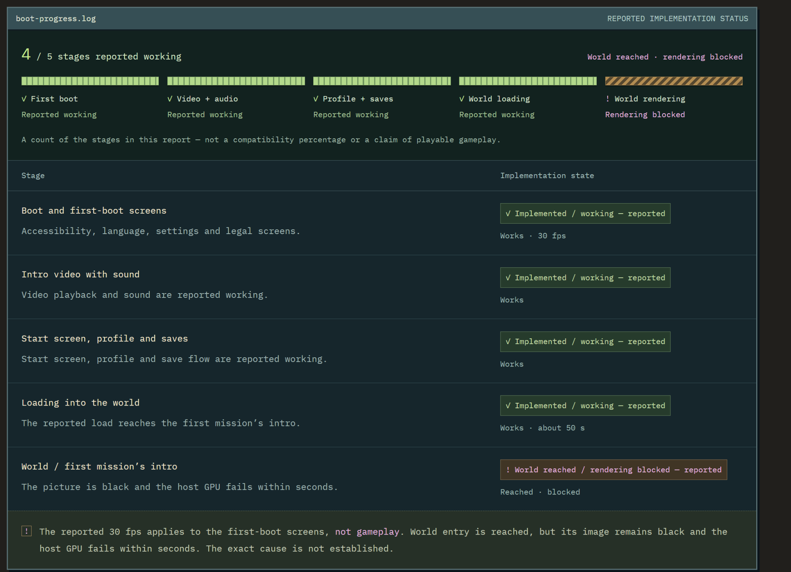

# Windows D3D12 runtime integration

This repository tracks work on running the Xbox Series build of GTA VI on Windows. It combines the original Leonida compatibility runtime with the separately selectable VIctory backend, which translates console shaders and presents through native D3D12. The two backends keep their runtime state separate.
**Tracking request:** [PortWatch issue #38](https://github.com/4lwayz/portwatch-vi/issues/38). This repository, `tudorek12345/VictoryIsInOurName.hep`, is the sole proposed reporting source for one integration effort. No separate entry is requested for the earlier Leonida repository. The previous request #17 was closed by its author, not rejected by PortWatch.

**Evidence status:** Maintainer-reported; no independent reproduction, editorial acceptance, or PortWatch score is claimed. See the [review packet](docs/portwatch-submission.md) for source attribution, the known takedown context, implementation evidence and limitations.

## Reported boot progress

24 November 2026

**Boot and menu reported working; attempted world transition ends in a black screen and GPU failure.** The historical report counted four of five local test stages, including the loading attempt. That count is not a compatibility percentage or confirmation that the game world rendered. The PortWatch rubric requires rendered world output and player control for its later milestones.

**Test system** · AMD Radeon RX 9060 XT with 16 GB VRAM · AMD Ryzen 7 5700X · 32 GB system RAM

| Stage | Reported state | What happened |
| --- | --- | --- |
| Boot and first-boot screens | **Working** | Accessibility, language, settings and legal screens displayed at a reported 30 FPS. |
| Intro video with sound | **Working** | The intro video played with sound. |
| Start screen, profile and saves | **Working** | The start screen, profile selection and save flow worked. |
| Loading transition | **Reported** | The maintainer reports reaching the first mission’s intro after about 50 seconds; world entry and rendering are not verified. |
| World rendering and player control | **Unverified · blocked** | The picture stayed black and the host GPU failed within seconds. The cause is unresolved. |

In the latest local update, the maintainer also reports seeing the **“Rockstar Games Presents”** title card. The exact runtime commit and a recording of that sequence are pending. Visible world geometry, player movement and gameplay FPS remain unverified.

**Short intro measurement** · The hardware run recorded **30 FPS / 33.3 ms** per frame. WARP software rendering recorded **about 10 FPS / 100 ms** per frame. These measurements cover the short intro. The 30 FPS in the first row is the maintainer’s separate first-boot observation.

[Plain-text boot-progress.log](boot-progress.log) · [Machine-readable run report](tracking/runtime-progress.json) · [PortWatch review notes](docs/portwatch-submission.md) · [PortWatch tracking request #38](https://github.com/4lwayz/portwatch-vi/issues/38)



The panel and log summarize the same historical report, not additional reproductions.


## Implementation and open work

The [integration checkpoint](https://github.com/tudorek12345/VictoryIsInOurName.hep/commit/298042a3388e400464824d246ed3ec265c238345) adds consistent raw bindless shader resource views (SRVs), typed UINT16 unordered access views (UAVs), exact 3:1 compositor downscaling and coalescing of concurrent shader-cache fills. D3D12 diagnostics record the submission caller, fence phase and Present result.

| Investigation | State | Result or outstanding question |
| --- | --- | --- |
| Trace single-list device removal | **Completed** | The trace narrowed device removal to a single-list submission. The defect responsible has yet to be identified. |
| Distinguish failure paths and retain the fence phase | **Completed** | Caller, fence and Present instrumentation distinguishes submission and presentation failures and records the fence phase. Fault attribution remains open. |
| Serial build, tests and debug reproduction | **In progress** | The local serial build passed. The workspace suite recorded **303 passed, 5 ignored**. The GPU crate recorded **62 passed, 2 ignored**. Original-file protection checks passed. The latest debug run could not enable the missing D3D12 debug layer and exited with code **0 after 28.42 seconds**, before world entry. |
| Fix the remaining defect and verify controllable gameplay on hardware | **Pending** | Reproduce the black screen on hardware, identify the cause, verify the fix, then record a visible world and response to player input. |

In the [Windows CI run for this implementation](https://github.com/tudorek12345/VictoryIsInOurName.hep/actions/runs/45355225342), the native release and diagnostics builds passed and the native runtime test job failed. The [source-boundary check](https://github.com/tudorek12345/VictoryIsInOurName.hep/actions/runs/45355225195) passed for the same commit. The serial test counts above come from the maintainer’s local run.

The next hardware run should record the exact build, GPU driver, title-card time, first black frame, last successful guest submission, host Present result and response to input. See the [experiment workflow](docs/EXPERIMENTS.md).

## Source-only validation

For an existing authorized source checkout, the source-only D3D12 build and synthetic diagnostics tests do not require game files. With the pinned Windows Rust toolchain:

```powershell
cd runtimes/victory
$env:VICTORY_WARP = '1'
$env:VICTORY_D3D12_WARP = '1'
cargo build --locked --profile diag -p victory --features diagnostics
cargo test --locked --workspace --features diagnostics -- --test-threads=1
```

Keep game files, saves, caches and generated artifacts outside Git. The [No Game Data workflow](.github/workflows/no-game-data.yml) checks tracked filenames and content signatures. It is a source-boundary check, not a legal determination. The [Windows CI definition](.github/workflows/victory-runtime.yml) documents source-only validation.

## Source boundary and review eligibility

The earlier Leonida repository was blocked by GitHub under a DMCA notice on 24 November 2026. This integration shares that runtime's lineage and preserves upstream attribution. See the [published notice](https://github.com/github/dmca/blob/master/2026/11/2026-11-24-take-two.md) and [source provenance](runtimes/victory/SOURCE.json). The current repository's accessibility is not a finding that the underlying copyright concerns are resolved.

No link to a removed repository, leaked executable, game files, keys, or alternative distribution location is requested for PortWatch. The submission is a request to review the reported technical observations only; eligibility and whether to publish a link are for PortWatch's maintainer to decide. If the source cannot be listed under its rules, a factual review without a distribution link may be considered at the maintainer's discretion. No attempt to circumvent a legal block is requested.

## Code and attribution

| Location | Purpose |
| --- | --- |
| [runtime/](runtime/) | Original Leonida compatibility runtime and Vulkan renderer |
| [runtimes/victory/](runtimes/victory/) | VIctory native D3D12 backend, shader translation and graphics tests |
| [Integration notes](INTEGRATION.md) | Local integration work and upstream provenance |
| [Technical documentation](docs/README.md) | Runtime, formats, graphics and validation |
| [Contribution guide](CONTRIBUTING.md) | Reproductions, source boundaries and coordination |

Heperkoo maintains this integration. Credit for the original Leonida runtime belongs to ItsNotRexed and the Leonida contributors. Credit for VIctory belongs to Marvisak and the VIctory contributors. See the [upstream pin and change record](runtimes/victory/SOURCE.json), [upstream credits](README.upstream.md#credits), [project license](LICENSE) and [VIctory license](runtimes/victory/LICENSE).
