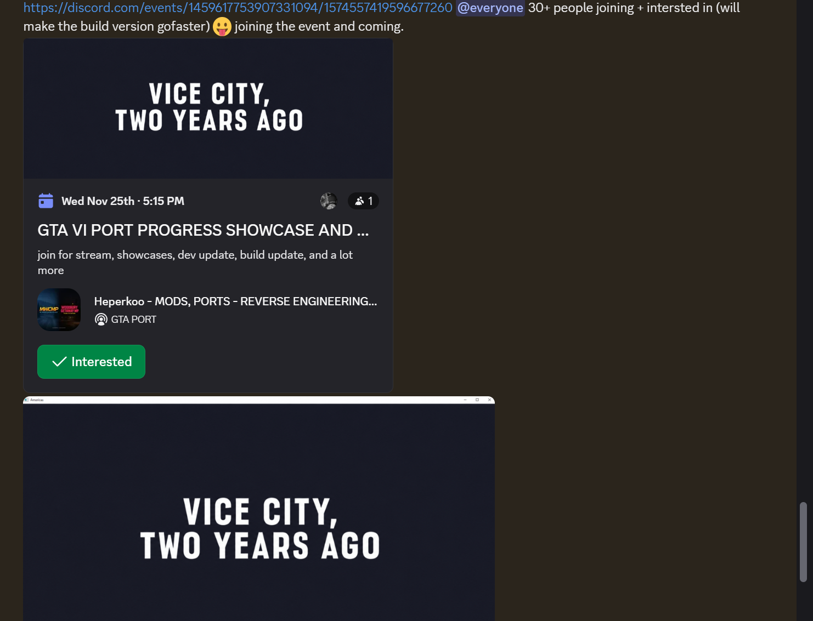

<div align="center">
  

# VictoryIsInOurName.hep · Heperkoo

**An experimental project working toward GTA VI running natively on PC.**

Fast, focused experiments. Reproducible progress. Clear developer handoffs.


[**PortWatch review request**](https://github.com/4lwayz/portwatch-vi/issues/17) ·
[**My Discord**](https://discord.gg/ufXqPcVdVj) ·
[**Developer handoff**](website/public/handoff.md) ·
)


</div>

> [!IMPORTANT]
> ### GTA VI port progress showcase
> **Wednesday, 25 November 2026** — join for streams, showcases, development discussion and build updates.
>
> **[Join the showcase on Discord](https://discord.com/events/1459617753907331094/1574557419596677260)**
>
> Open the event for the start time in your local timezone. The separate possible reproducible-build target remains 30 November.

[](https://discord.com/events/1459617753907331094/1574557419596677260)


https://leonida-heperkoo.meshedgoby9.chatgpt.site/

## Latest progress — 24 November 2026, 03:00 EST (UTC−05:00)

**Source fixes and diagnostics are implemented; controllable gameplay is not verified.** This update concerns the integrated **VIctory / native D3D12** backend in `runtimes/victory`, based on fork checkpoint `5dd9c2c21093e17d16ec577c76a9e721e3a08c59`. It is separate from the older Leonida/Vulkan path and the historical RX 9070 XT report.

### Recent changes

- **Shader correctness:** scalar and vector byte reads using the same direct-heap SSA descriptor now agree on the raw SRV type; separate CBVs and fixed structured SRVs retain their paths. Added synthetic GPU readback coverage.
- **Typed UINT16 UAVs:** fixed compute tables specialize R16_UINT and R16G16B16A16_UINT buffer loads/stores and matching null views. Synthetic readback passes; this does not prove the title's device loss is fixed.
- **Presentation:** exact 3:1 downscaling uses a direct texel read, retaining both display planes, premultiplied blending and the linear fallback at other scales. Synthetic 720p WARP compositor median: **1.848 → 1.673 ms**; hardware: **0.246 → 0.244 ms**. These are compositor-only measurements, not title FPS gains.
- **Shader cache:** identical concurrent cold requests coalesce into one translation; unrelated keys remain concurrent. Added repair, failure, retry and unwind coverage. The normal world pipeline already shares base translation, so a world-loading speedup is not established.
- **Device-loss diagnostics:** report the submission caller, fence value/completion, exact Signal/event/wait failure phase, split-list device status and swap-chain Present removal. Instrumentation identifies future failures; it has not yet attributed the remaining crash to a particular command.
- **Local workflow:** named VS Code terminals, deterministic owned background tasks and sequential Cargo tasks were tested. Session subagents performed independent analysis/review. These workstation helpers are not autonomous AI workers and are not installed globally.

### What was actually measured

One local Windows system: **Radeon RX 9060 XT 16 GB · Ryzen 7 5700X · 32 GB DDR4**. Series S profile, requested 720p. No independent reproduction or broad compatibility claim.

| Check | Observed result / limit |
| --- | --- |
| Optimized diagnostics build | Passed on Rust 1.98.1, Windows x64 |
| Serial workspace tests, diagnostics feature | **303 passed, 0 failed, 5 ignored**; includes synthetic shader, compositor and cache tests |
| Latest focused GPU crate rerun | **62 passed, 0 failed, 2 ignored** |
| Radeon intro, short bounded run | **30 FPS / 33.3 ms**; intro only, **not gameplay** |
| WARP software intro without capture | Approximately **10 FPS / 100 ms**; not Radeon performance |
| Last completed WARP world-transition failure | **0x887A0005 device removal at 184.84 s**, peak job commit **11.02 GiB** of a 16 GiB cap; a 31-list batch completed before the failing one-list submission. Exact caller/command remains unresolved for that older trace. |
| Latest requested debug repro | Ended after **28.42 s**, exit 0 during lifecycle shutdown, **before world entry**. The requested D3D12 debug layer was unavailable. This is **not** a successful world-entry/debug-validation result. |
| Original-package protection | Read-only isolated package access; runner verified ACL restoration on **151 paths**, with the executable SHA-256 unchanged. No memory-cap hit demonstrated. |

### Latest tasks / where we stopped

- [x] Trace the single-list device removal and inspect the working-copy source and run evidence.
- [x] Distinguish guest and presenter failure paths and retain the exact fence phase in diagnostics **(instrumentation implemented; fault attribution still pending)**.
- [ ] **In progress:** build and test serially, then run the bounded debug repro and verify original-file protection. Build/tests and protection checks passed; the latest debug attempt was inconclusive because the debug layer was unavailable and the run ended before world entry.
- [ ] Fix any demonstrated remaining defect and verify controllable hardware gameplay.

**Next experiment:** check debug-layer availability without changing the system silently; reproduce world entry in one bounded isolated run using the new caller/fence diagnostics. Separate guest execution from presentation/capture failure before choosing a fix. Add a synthetic regression, rerun serially, then verify hardware world rendering, input/audio and gameplay frame-time percentiles. Do not overlap GPU tests and title runs or change TDR/driver settings to hide a failure.

The [public handoff](website/public/handoff.md), [brief progress report](website/public/progress-update.md) and [sanitized results/checklist](tracking/runtime-progress.json) are source-only references. Full raw traces, captures, extracted shaders, game files, caches and saves stay local. The newly created workstation `handoff.md` and `currenstatus.md` are intentionally ignored; no blanket Markdown ignore hides project documentation.

**PortWatch VI:** [issue #17](https://github.com/4lwayz/portwatch-vi/issues/17) is the maintainer-review channel. Heperkoo’s Leonida and its VictoryIsInOurName.hep companion mirror represent one runtime integration. The canonical source and showcase are maintained in [tudorek12345/Leonida](https://github.com/tudorek12345/Leonida). PortWatch’s editors determine listing and milestones.

### Publication verification — 24 November 2026, 03:17 EST

The implementation commit **[`298042a3`](https://github.com/tudorek12345/Leonida/commit/298042a3388e400464824d246ed3ec265c238345)** was pushed to `main` in both repositories, with identical Git tree and README blob hashes. The brief EST-dated update and checked/unchecked tasks were [submitted to PortWatch](https://github.com/4lwayz/portwatch-vi/issues/17#issuecomment-7125717267); its maintainer still controls acceptance and deployment. The project website's updated **source** passed CI; the existing hosted Sites deployment was not updated by that build.

- [Website CI](https://github.com/tudorek12345/Leonida/actions/runs/45352873274): **tests, typecheck and production build passed**.
- [No Game Data CI](https://github.com/tudorek12345/Leonida/actions/runs/45352873203): **passed** for the implementation commit.
- [Native CI](https://github.com/tudorek12345/Leonida/actions/runs/45352873288): **release and diagnostics builds passed**, but the shader-test process failed with **0xC0000005 / STATUS_ACCESS_VIOLATION** under the workflow's parallel test configuration. The [preceding baseline run](https://github.com/tudorek12345/Leonida/actions/runs/45337573770) shows the same failure signature; its exact cause is not established. This is distinct from the passing local serial diagnostics suite.
- The broader legacy CI is **not fully green**. Do not treat the local passing tests or successful website build as an all-CI pass.
- [ ] Investigate the native CI access violation and remaining legacy CI failures without dropping tests or assertions.

Publication receipts and CI limits are recorded in [the sanitized results](tracking/runtime-progress.json). No new game captures or raw game evidence were included in these changes.

<details>
<summary>Historical maintainer report — 23 November 2026 (different RX 9070 XT machine)</summary>

Boot/setup screens were reported at 30 FPS, intro/audio and profile/saves working, loading around 50 seconds, followed by a black first-mission image and host GPU failure. Those supplied observations were not independently reproduced and are not the RX 9060 XT measurements above. Stable gameplay remains unverified.

</details>

## What I’m building

I’m **Heperkoo** ([tudorek12345](https://github.com/tudorek12345)). This is my working fork of Leonida for reverse engineering, runtime integration, testing and collaboration.

The current goal is the **shortest practical route to stable world rendering on PC and a reproducible path into gameplay**. I want each experiment to answer a concrete question, remove the next measured blocker and leave work another developer can continue immediately.

The original Leonida runtime executes the game’s existing x86-64 CPU code through reimplemented console services, with console GPU programs translated for Vulkan. The separately integrated **VIctory backend uses native D3D12** and translated console shaders. Full credit for those foundations belongs to **ItsNotRexed and the upstream Leonida contributors**, and **Marvisak/VIctory and its contributors**, respectively; this is a fork/integration, not a new original engine.

## Current status

| Area | Status |
| --- | --- |

| Developer handoff and experiment workflow | Available · [handoff](website/public/handoff.md) · [experiment notes](docs/FORK_EXPERIMENTS.md) |
| Runtime work in this fork | Integrated VIctory shader/UAV fixes, compositor/cache changes and device-loss diagnostics; serial synthetic tests pass |
| Stable world rendering and gameplay in this fork | **Not yet verified**; the remaining world-entry device removal is unresolved |
| Release date | No committed date; milestones depend on measured results |

### Historical upstream reference

The [pinned upstream retail experiment from 23 November 2026](https://github.com/ItsNotRexed/Leonida/blob/8e3c7c72b79cabfbe8a2059fce56a5b99d6ddb51/docs/retail_boot_chain.md) documents an earlier, separate run that reached graphics initialization and a descriptor-heap assertion, with no draw or presentation demonstrated in that run. It used locally combined changes and stand-ins. Keep it as historical context: the latest maintainer report above has progressed to world loading and identifies black output followed by a host GPU failure as the next investigation.

## Experience I bring

My ongoing work already involves multiplayer systems, native engine investigation, porting and testing:

| Project | Relevant experience |
| --- | --- |
| **My Winter Car Multiplayer (MWCMP)** | Multiplayer state synchronization, mod integration, Steam/LAN transport and debugging interactions across running instances |
| **Batman Telltale port** | Godot porting work, scene and asset integration, rendering and visual iteration |
| **[CoD2SP-CO-OP](https://github.com/tudorek12345/CoD2SP-CO-OP)** | Native x86 runtime integration, exact-build engine calls, calling conventions, signature checks and host-authoritative UDP |
| **[TWD source recovery](https://github.com/tudorek12345/decomptwdgame1season)** | C++ reconstruction experiments, hybrid native execution and differential testing |

I work in **VS Code with Codex**, using AI assistance for investigation, implementation and parallel analysis. The useful part is closing the loop: inspect the behavior, make a focused change, run it, and document what actually happened. These projects remain ongoing work.

## How I want to move quickly

1. **Start from current upstream work.** Compare the actual commits and active work before implementing a fix somebody already has.
2. **Follow the first reproducible failure.** Use startup traces and small probes to choose the next loader, memory, ABI or graphics experiment.
3. **Change one behavior at a time.** State the hypothesis, expected result and rollback before changing shared runtime code.
4. **Keep the feedback cycle short.** Reuse valid shader/build outputs, skip optional full asset exports during boot work, and run the tests relevant to the changed behavior.
5. **Parallelize independent questions.** Loader/memory, graphics/ABI and reproduction can move together when ownership and interfaces are clear.
6. **Keep only demonstrated progress.** Compare before and after, preserve useful negative results, then hand off the exact next experiment.


```powershell
python -I make_game.py --game "D:\Games\GTA-VI-package" --stages check,shaders,runtime --out "D:\Leonida\runtime" --work "D:\Leonida\work"
```

The repository contains source and tools. Supply your own locally readable game files; keep game content and generated artifacts outside Git. The [boot runbook](docs/boot.md) and [developer handoff](website/public/handoff.md) cover the next stages.

## Collaborate

### Files and tools for the current investigation

Paths below are relative to `runtimes/victory/` unless stated otherwise.

| Files | Role |
| --- | --- |
| `crates/victory-shader/src/emit/lower.rs`, `mod.rs`, `host.rs`, `valu_tests.rs` | Raw descriptor inference, typed UINT16 specialization and hand-written synthetic readback fixtures |
| `crates/victory-gpu/src/descriptor/host.rs`, `draw.rs` | Typed/null host views and specialization selection |
| `crates/victory-gpu/src/present.rs`, `present/tests.rs` | Compositor fast path, blending/scaling correctness and opt-in A/B benchmark |
| `crates/victory-gpu/src/shader_cache.rs`, `crates/victory-pipeline/src/cache.rs` | Keyed cold-fill coalescing, concurrency/failure tests and cache integration |
| `crates/victory-gpu/src/host.rs`, `queue.rs`, `capture.rs`, `frame.rs`, `list.rs` | Submission, present/capture, timing and failure investigation |
| Root `runtime_backend.py`, `run_runtime.cmd`, `.github/workflows/victory-runtime.yml` | Backend bridge and Windows build/test workflow |
| Root `tracking/runtime-progress.json`, `website/app/lib/progress-update.ts` | Sanitized observations and timestamped website/checklist data |

AI-assisted workflow skills used: **`game-reverse-engineering`** and **`reverse-engineer-anything`** for evidence discipline; **`review-agent`** for static defect review; **`tinyfish-web`** / **`tinyfish-authenticated`** for selecting safe public-read/submission routes. Ghidra/ILSpy capabilities were checked, but no fresh broad decompilation was needed for these source fixes. Skills are local agent instructions, **not runtime dependencies or files distributed by this repository**.

Reproduce the source-only checks on Windows with the pinned Rust toolchain:

```powershell
cd runtimes/victory
$env:VICTORY_WARP = '1'
$env:VICTORY_D3D12_WARP = '1'
cargo build --locked --profile diag -p victory --features diagnostics
cargo test --locked --workspace --features diagnostics -- --test-threads=1
```

Use external game/state/cache directories as required by the runtime policy. The local isolated launcher `Test-Victory-World.ps1`, `isolated-run` helper and `dev-tasks` workspace remain workstation-specific tools outside Git; the ignored handoff records their exact local paths and commands.

**[Join my Discord / MWCMP community](https://discord.gg/ufXqPcVdVj)** for discussion, coordination and project updates. This is my existing development community.

For changes that need to stay traceable, use this fork’s [pull requests](https://github.com/tudorek12345/Leonida/pulls). Useful contributions include C++ runtime work, Windows internals, calling-convention analysis, memory behavior, Vulkan/graphics integration and reproducible GPU testing.

Bring a commit, a specific question, the commands you ran, the result and the next blocker. Check [CONTRIBUTING.md](CONTRIBUTING.md), [AGENTS.md](AGENTS.md) and current upstream coordination before overlapping runtime work.


## Credits and license

**Leonida was created by [ItsNotRexed](https://github.com/ItsNotRexed/Leonida) and its contributors.** This fork builds on their work. Original attribution, the [upstream dependency and artwork credits](README.upstream.md#credits), and third-party licenses remain applicable.

Huge respect to Marvis for the ongoing code research and collaboration. This research programme is committed to working under applicable law.

GPLv3 or later — see [LICENSE](LICENSE). Runtime changes, review, website and documentation work are AI-assisted.

Independent community research; not affiliated with Rockstar Games, Take-Two Interactive or Microsoft.
